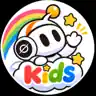

# Grok Bot Avatar Designer

这是从此前关于 Grok Bot 主题头像的多轮设计讨论整理出的可复用 Skill，目标是让系列 Bot 头像既有统一的机器人视觉语言，也能通过颜色、道具和姿势快速区分。

## 🖼️ 头像作品展示 / Avatar Gallery

以下作品均选自我们此前生成的头像，展示的是经过压缩的预览缩略图，便于 GitHub 首页快速加载。点击图片可打开仓库内对应文件。

| Astro / PS5 游戏 | Cripy / Bitcoin | Kids / 儿童 | Moomoo / 证券 |
|:---:|:---:|:---:|:---:|
| [](assets/examples/asobi.webp) | [](assets/examples/cripy.webp) | [](assets/examples/kids.webp) | [](assets/examples/moomoo.webp) |
| **清爽游戏蓝** | **金橙理财** | **多彩童趣** | **活力橙牛角** |

> 这些是设计示例和非官方概念作品，不表示与所参考品牌存在授权、合作或认可关系。仓库内只发布展示用小尺寸预览，原始高清素材不在此仓库中。

## ✨ 设计原则

- **统一而不复制**：保留友好、圆润的 Bot 家族识别特征，但每个主题改变配色、姿势和构图。
- **小尺寸高辨识度**：缩小到聊天列表图标大小，依然能认出核心元素。
- **简洁优先**：避免同一套发光光圈、星空背景和挥手姿势在所有头像里重复。
- **自然融合**：把 Logo、主题图形或道具融入造型，不做明显的“贴纸式”叠加。

## 📁 文件结构

```text
grok-bot-avatar-designer/
├── README.md
├── SKILL.md
├── assets/
│   └── examples/
│       ├── asobi.webp
│       ├── cripy.webp
│       ├── kids.webp
│       └── moomoo.webp
└── references/
    ├── theme-library.md
    └── prompt-templates.md
```

- [**SKILL.md**](SKILL.md)：核心设计原则、生成流程和验收标准
- [**主题设计库**](references/theme-library.md)：历史主题、配色、差异化姿势与修改偏好
- [**提示词模板**](references/prompt-templates.md)：新头像、批量设计、统一风格、局部修改

## 🚀 使用方式

将整个仓库的 Skill 文件夹放到支持自定义 Skills 的工具所要求的目录，或将 `SKILL.md` 作为设计指令交给支持该格式的助手。具体安装方式因产品而异。

示例：

> 使用 Grok Bot Avatar Designer 风格，为一个以日本旅行规划为主题的 Bot 创建头像。突出地图和富士蓝配色，避免与已有的 Kids、Bitcoin 和 PS5 头像同质化。

若要编辑旧头像，请在当前任务中提供原始图片；本仓库中的展示预览不适合作为高分辨率编辑原件。
